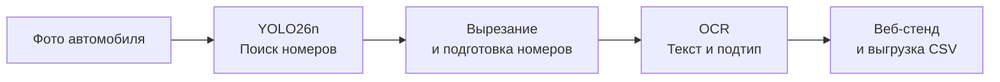

# Распознавание российских ГРЗ

**russian-license-plate-anpr** — детектор и OCR для государственных регистрационных знаков РФ по ГОСТ Р 50577-2018, включая нестандартные типы.

YOLO26n находит номера на изображении, OCR распознаёт текст и определяет подтип. Основной фокус — обычные номера `type1`, двухстрочные `type1a` и жёлтые `type1b`. Проверять результат можно через веб-стенд.

## Быстрый старт: запустить стенд

Нужен Python 3.11+ (проверено на 3.14) и готовые веса `checkpoints/plate_detector.pt` и `checkpoints/plate_recognizer.pt`. Веса не входят в репозиторий и отсутствуют в новом клоне. Разместите их локально по инструкции «Локальные веса моделей: не публиковать» ниже.

Команды выполняются **из корня проекта в PowerShell**:

```powershell
python -m venv .venv
.\.venv\Scripts\Activate.ps1
python -m pip install -r generator/requirements.txt
python -m pip install torch==2.14.0 --index-url https://download.pytorch.org/whl/cu126
python -m pip install ultralytics==8.4.150 fastapi uvicorn python-multipart tqdm
python full_stand/app.py --port 8080
```

Дождитесь запуска сервера и откройте **[http://127.0.0.1:8080](http://127.0.0.1:8080)**. Перетащите фотографии в окно: стенд покажет найденные номера, текст, тип и уверенность распознавания. Результаты можно выгрузить кнопкой CSV.

Стенд автоматически использует GPU, если доступна CUDA, иначе работает на CPU. Для принудительного запуска без GPU добавьте `--device cpu`. После установки зависимостей и подготовки весов интернет для работы стенда не нужен.

## Как это работает

Каждое изображение проходит через детектор и распознаватель. Если в кадре несколько номеров, результат формируется для каждого из них.



1. **Поиск номера.** YOLO26n находит рамки номерных знаков на исходной фотографии. У детектора один класс — номер; его текст и подтип определяются следующим этапом.
2. **Распознавание.** Каждый найденный номер вырезается с небольшими полями и приводится к подходящему размеру с учётом соотношения сторон. OCR на основе трансформера определяет подтип и последовательно читает символы, учитывая допустимые буквы и цифры для каждой позиции.
3. **Вывод результата.** Стенд показывает рамки на исходном изображении, вырезанные номера, распознанный текст, подтип и уверенность моделей. Изображения обрабатываются через очередь, результаты появляются по мере готовности.

OCR различает 29 подтипов по каталогу ГОСТ и класс `unknown`. Это позволяет отдельно определять обычные, двухстрочные, жёлтые, военные и другие номера. В CSV сохраняется полный подтип вместе с текстом и оценками уверенности.

## Какие данные используются

**Детектор** обучается на фотографиях с размеченными рамками номеров. **OCR** — на вырезанных реальных номерах с текстовой разметкой и синтетике собственного генератора.

| Задача | Источник | Изображений после отбора |
|---|---|---:|
| Детекция | [AUTO.RIA / Nomeroff Net](https://nomeroff.net.ua/), архив 2026-06-04 | 19 888 |
| Детекция | [Car_plate_detecting_dataset](https://huggingface.co/datasets/AY000554/Car_plate_detecting_dataset) | 24 822 |
| Детекция | [Car plate object detection](https://www.kaggle.com/datasets/andrewteplov/car-plate-object-detetcion) | 482 |
| Детекция | [Number plates, 50% Russian / 50% others](https://www.kaggle.com/datasets/kirillpribludenko/number-plates-50-russain-50-others) | 369 |
| OCR | [AUTO.RIA OCR RU, 2021-09-01](https://web.archive.org/web/20220514070933id_/https://nomeroff.net.ua/datasets/autoriaNumberplateOcrRu-2021-09-01.zip), гражданские номера | 56 611 |
| OCR | [AUTO.RIA OCR RU Military, 2022-03-25](https://web.archive.org/web/20220514075608id_/https://nomeroff.net.ua/datasets/autoriaNumberplateOcrRu-Military-2022-03-25.zip), военные номера | 27 513 |
| OCR | [MADE CV / Car plates OCR](https://www.kaggle.com/datasets/xairete/car-plates-ocr), кропы по полигонам разметки | 26 799 |
| OCR | [Car_plate_OCR_dataset](https://huggingface.co/datasets/AY000554/Car_plate_OCR_dataset), уникальная часть | 4 747 |

## Как сгенерировать данные

Используйте окружение из быстрого старта. Основной вариант генерации работает через **Blender Cycles на NVIDIA GPU**. Подготовьте Blender, затем создайте выборку:

```powershell
python -m generator.setup --blender
python -m generator generate outputs/synthetic --count 5000 --seed 42 --backend cycles --device CUDA --profile gost --preview
python -m generator validate outputs/synthetic
```

Для небольшой пробы уменьшите `--count`, например до 32. Генерация через `--backend cpu` доступна без Blender и GPU — в этом случае первый шаг можно пропустить.

Генератор выбирает тип и текст номера, строит знак по геометрии ГОСТ, затем моделирует съёмку: меняет ракурс, освещение, загрязнение, блики и смаз. Вместе с изображением автоматически создаётся разметка текста, типа и положения знака. Так можно дополнить реальные данные примерами редких типов и разных условий съёмки.

Для текущего OCR используется профиль `gost`. Количество задаётся через `--count`, seed — через `--seed`; только целевые типы можно выбрать через `--types type1 type1a type1b`.

В `outputs/synthetic/` появятся изображения, разметка `annotations.jsonl`, конфигурация и отчёт о генерации. Посмотреть примеры можно в `preview.jpg` или `gallery.html`. Этот же каталог передаётся в обучение OCR.

## Как обучить модели

Примеры ниже рассчитаны на **одну NVIDIA GPU** и окружение из быстрого старта. Для OCR сначала сгенерируйте синтетику командой выше.

### Детектор

```powershell
yolo detect train model=yolo26n.pt data=real_plates2/yolo_plates_ru2/data.yaml `
    epochs=400 patience=40 imgsz=640 batch=16 device=0 project=outputs name=detector
```

Начальные веса `yolo26n.pt` скачиваются автоматически. Лучшие веса сохраняются в `outputs/detector/weights/best.pt`; при повторных запусках имя каталога может получить числовой суффикс.

### OCR

Обучение на реальных номерах и сгенерированных изображениях, валидация — на отдельной реальной выборке:

```powershell
python ocr_model/run_training.py `
    --data real_plates2/ocr_plates_ru/train.tsv outputs/synthetic `
    --val-data real_plates2/ocr_plates_ru/val.tsv `
    --output outputs/ocr --epochs 25 --gpus 0 --batch-size 32 --workers 4
```

Лучшие веса сохраняются в `outputs/ocr/best.pt`, последние — в `outputs/ocr/last.pt`. Для проверки одного шага добавьте `--dry-run`. При нехватке видеопамяти уменьшите батч; если GPU не поддерживает BF16, добавьте `--amp none`.

Для обучения только на реальных данных уберите `outputs/synthetic` из команды. Передавайте `train.tsv` и `val.tsv` отдельно, чтобы сохранить готовое разделение данных.

Поставляемые веса `checkpoints/plate_recognizer.pt` обучены 25 эпох на **2 386 685 изображениях**: 109 886 реальных кропов из `real_plates2/ocr_plates_ru/train.tsv` и 2 276 799 синтетических. Синтетика закрывает все 29 подтипов, с упором на основные: `type1` — 283 660 изображений, `type1a` — 313 639, `type1b` — 287 707, у остальных типов по 52–54 тысячи. Валидация смешанная: 5 784 реальных кропа и 43 413 синтетических, доля полностью верных ответов (текст и подтип одновременно) на ней — 0.976.

### Проверить свои модели на стенде

```powershell
python full_stand/app.py `
    --detector outputs/detector/weights/best.pt `
    --recognizer outputs/ocr/best.pt --port 8080
```

Откройте тот же адрес [http://127.0.0.1:8080](http://127.0.0.1:8080) и загрузите изображения для проверки.

Полный список параметров доступен через `--help` у соответствующей команды.

## Ровер: локальный запуск и Docker

Локально (macOS/Linux): `make install` создаёт `.venv` и ставит
`requirements.txt`. Подготовьте собственный `.env` по `.env.example`, затем
`make run`; `make stop` останавливает процессы. На Mac оставьте `DEVICE=mps`,
для CPU задайте `DEVICE=cpu`. Веса должны находиться в `checkpoints/`.
`make purge` останавливает процессы и **удаляет `.run` с PID и логами**;
база, снимки и веса сохраняются. Не запускайте очистку без необходимости.
Инструменты качества устанавливаются отдельно:
`.venv/bin/pip install -r requirements-dev.txt`; проверка — `make check`.

Compose по умолчанию использует CPU и не требует GPU. Команды:

```sh
make docker-config
make docker-install
make docker-run
make docker-stop
```

Для Ubuntu x86_64/NVIDIA нужен драйвер, совместимый с CUDA 12.6,
NVIDIA Container Toolkit и Compose с поддержкой `gpus: all`:

```sh
make docker-config COMPOSE_FILES="-f compose.yaml -f compose.cuda.yaml"
make docker-install COMPOSE_FILES="-f compose.yaml -f compose.cuda.yaml"
make docker-run COMPOSE_FILES="-f compose.yaml -f compose.cuda.yaml"
make docker-stop COMPOSE_FILES="-f compose.yaml -f compose.cuda.yaml"
```

В Docker MPS недоступен; Docker Desktop на Mac использует CPU. Доступ USB
в контейнер автоматически не предоставляется: на Linux нужен отдельный
локальный override с `devices` и группой устройства. На Mac USB-камеру
используйте через локальный запуск либо выберите доступный RTSP-поток.

Камера читает `.env` через Compose; этот файл не включается в образ.
Для другого файла задайте `ANPR_ENV_FILE`. Для Hikvision укажите собственный
RTSP URL в `VIDEO_SOURCE`; реальные адреса и пароли в README не размещаются.
`VIDEO_RETRY_INITIAL`, `VIDEO_RETRY_MAX`, `VIDEO_OPERATION_TIMEOUT` управляют
переподключением; `DELIVERY_*` — доставкой. В контейнере принудительно заданы
внутренний адрес API, CPU/CUDA и отсутствие графического окна. Не публикуйте
вывод обычного `docker compose config`: он может раскрыть секреты.
`make docker-config` использует только `.env.example` и тихую проверку.

API доступен на `127.0.0.1:8000`; `/health` подтверждает запуск HTTP-приложения
после инициализации SQLite, но не проверяет камеру или качество OCR.
Камера стартует после успешного healthcheck API; последующие сбои API
обрабатывает очередь доставки. Оба сервиса перезапускаются `unless-stopped`.

Контейнеры работают под UID/GID 10001. SQLite и снимки хранятся в именованных
volumes `anpr-data` и `anpr-captures`, начальные права задаются образом.
Существующие локальные `plates.db`, `data/` и `captures/` автоматически
не переносятся. Для bind mounts заранее подготовьте права UID/GID 10001;
не меняйте владельцев пользовательских данных вслепую.
`make docker-stop` сохраняет volumes. `make docker-purge` удаляет контейнеры
и локальные образы, но не volumes; `docker compose down -v` удаляет данные.

Образ камеры явно копирует runtime-модули, `full_stand` и `ocr_model`.
Модели подключаются через read-only volume. Генератор и датасеты не нужны.
Основные Docker-зависимости
закреплены по версиям локального окружения; транзитивные зависимости,
базовые образы и apt-пакеты пока не зафиксированы по хешам. Это ещё не полный
lock для воспроизводимой сборки. Образы не проверены сборкой в текущей среде;
совместимость CUDA и производительность требуют проверки на целевой машине.


## Локальные веса моделей: не публиковать

Checkpoint не входят в Git, Docker build context, образ или release-артефакты.
Права распространения пока не подтверждены. Получите оба файла из своего
разрешённого локального источника; автоматическое скачивание не настроено.
Создайте каталог `checkpoints` в корне проекта и вручную разместите:

- `checkpoints/plate_detector.pt`
- `checkpoints/plate_recognizer.pt`

На Ubuntu: `mkdir -p checkpoints`, затем скопируйте файлы локально.
На Windows PowerShell: `New-Item -ItemType Directory -Force checkpoints`,
затем скопируйте файлы через проводник или `Copy-Item`.
Для локального запуска пути одинаковы на Windows и Ubuntu; Makefile требует
POSIX shell, поэтому на Windows используйте WSL либо команды Python из README.
Устройство задаётся через DEVICE: cpu/cuda, на локальном Mac — mps.

Compose подключает `./checkpoints` к `/app/checkpoints` только для чтения.
Каталог должен существовать до запуска, файлы должны быть доступны UID 10001
на чтение (и каталоги — на проход). Не меняйте владельцев исходных весов
вслепую. Сборка образа не требует файлов моделей; запуск OCR без них завершится
ошибкой проверки путей. Для standalone Docker используйте эквивалент
`--mount type=bind,source=/absolute/path/checkpoints,target=/app/checkpoints,readonly`.
Не добавляйте веса в Releases, архивы рабочего каталога или слои образа.
Локальные контрольные суммы можно сверить `sha256sum checkpoints/*.pt`
(Ubuntu) или `Get-FileHash checkpoints/*.pt -Algorithm SHA256` (PowerShell).


## Локальные изображения глифов генератора

25 PNG-файлов `generator/assets/gost2018/` не входят в Git: права
распространения не подтверждены. JSON-описания остаются в репозитории.
Для генерации разместите локальные изображения из разрешённого источника
по именам в `generator/assets/gost2018/source.json`; сверяйте SHA-256.
Не добавляйте изображения в Git или release-артефакты. Генерация без этих
ресурсов может быть недоступна; файлы автоматически не скачиваются.

По проверенной цепочке импортов `camera.py -> full_stand.pipeline ->
ocr_model/nn` и `ocr_model/utils` распознавание не импортирует генератор
и не читает его глифы или шрифты. Для инференса нужны отдельно размещённые
checkpoint, а не ресурсы синтетической генерации. Проверка выполнена
статически; модели и камера при подготовке публикации не запускались.
