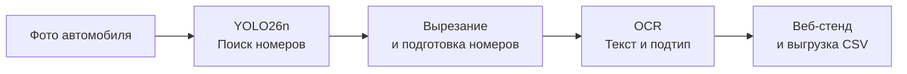

# Веб-стенд и конвейер распознавания

## Быстрый старт: запустить стенд

Нужен Python 3.11+ (проверено на 3.14) и готовые веса `checkpoints/plate_detector.pt` и `checkpoints/plate_recognizer.pt`. Веса не входят в репозиторий и отсутствуют в новом клоне. Разместите их локально по [инструкции размещения моделей](local-resources.md).

Команды выполняются **из корня проекта в PowerShell**:

```powershell
python -m venv .venv
.\.venv\Scripts\Activate.ps1
python -m pip install -r generator/requirements.txt
python -m pip install torch==2.14.0 --index-url https://download.pytorch.org/whl/cu126
python -m pip install ultralytics==8.4.150 fastapi uvicorn python-multipart tqdm
python full_stand/app.py --port 8080
```

Дождитесь запуска сервера и откройте **[http://127.0.0.1:8080](http://127.0.0.1:8080)**. Перетащите фотографии в окно: стенд покажет найденные номера, текст, тип и уверенность распознавания. Результаты можно выгрузить кнопкой CSV.

Стенд автоматически использует GPU, если доступна CUDA, иначе работает на CPU. Для принудительного запуска без GPU добавьте `--device cpu`. После установки зависимостей и подготовки весов интернет для работы стенда не нужен.

## Как это работает

Каждое изображение проходит через детектор и распознаватель. Если в кадре несколько номеров, результат формируется для каждого из них.



1. **Поиск номера.** YOLO26n находит рамки номерных знаков на исходной фотографии. У детектора один класс — номер; его текст и подтип определяются следующим этапом.
2. **Распознавание.** Каждый найденный номер вырезается с небольшими полями и приводится к подходящему размеру с учётом соотношения сторон. OCR на основе трансформера определяет подтип и последовательно читает символы, учитывая допустимые буквы и цифры для каждой позиции.
3. **Вывод результата.** Стенд показывает рамки на исходном изображении, вырезанные номера, распознанный текст, подтип и уверенность моделей. Изображения обрабатываются через очередь, результаты появляются по мере готовности.

OCR различает 29 подтипов по каталогу ГОСТ и класс `unknown`. Это позволяет отдельно определять обычные, двухстрочные, жёлтые, военные и другие номера. В CSV сохраняется полный подтип вместе с текстом и оценками уверенности.
